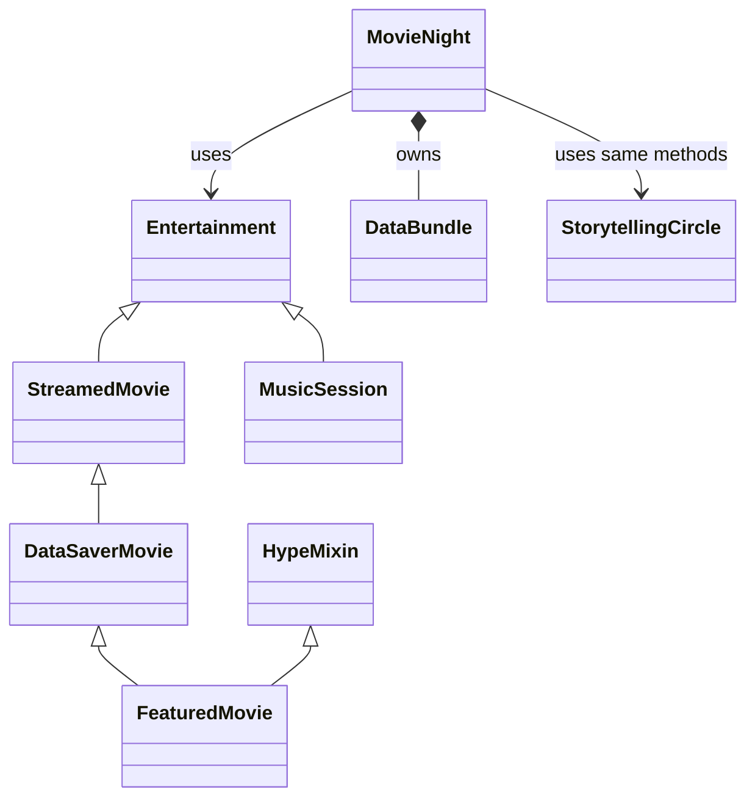

# Hostel Movie Night

Faith promised a hostel movie night, but a full movie costs more data than her bundle contains. The group needs a plan B.

This story includes all the OOP concepts from Weeks 1 to 6. The numbers are made up for learning.

## Group assignment

The combined assignment is due at the end of **Wednesday, 21 October 2026, Uganda time**. Keep your [foundation work](EXTENSIONS.md), then choose three [later-topic extensions](ADVANCED_EXTENSIONS.md). Each member contributes foundation work and new code or meaningful automated tests through reviewed PRs. The [common assignment](../../GROUP_ASSIGNMENT.md) explains the workflow and what to submit.

## Run this story

If you have not downloaded the files yet, follow [Start here](../../START_HERE.md).

1. Open the repository folder in VS Code.
2. Open `stories/03_hostel_movie_night/story.py`.
3. Choose **Run Python File in Terminal**, or use the command below.

From a terminal in the main repository folder:

**Windows:**

```sh
py -3 stories/03_hostel_movie_night/story.py
```

**macOS or Linux:**

```sh
python3 stories/03_hostel_movie_night/story.py
```

The whole story prints without asking you to type anything. Open [expected_output.txt](expected_output.txt) to see the output of the unchanged program.

## Read the five acts

**Act 1 — the rule keeper.** `DataBundle` keeps the changing resource. Its constructor sets a valid starting value. Its property getter reads that value. Its setter refuses a negative value. Its action method refuses a request that does not fit.

**Act 2 — the family.** `Entertainment` is an abstract class. It says that every concrete member of the family must provide `data_cost()`. `StreamedMovie` and `MusicSession` provide different versions. `super().__init__()` reuses the parent's setup.

**Act 3 — the special choices.** `DataSaverMovie` extends `StreamedMovie`. `FeaturedMovie` adds the description from `HypeMixin` using multiple inheritance. `StorytellingCircle` is not in the same family but provides the methods the program needs.

**Act 4 — the coordinator.** `MovieNight` creates and owns a `DataBundle`. It receives a choice object, asks it for its behaviour and lets the resource object check the request. Successful actions go into its own history list. `activities` reads the length of that list and has no setter.

**Act 5 — the complete story.** `main()` creates the objects and runs their actions. Two coordinator objects show that one person's resource and history are separate from another's.

## One request, step by step

`faith.enjoy(options[2])` asks the featured movie for its data cost. `DataSaverMovie.data_cost()` calls the streamed-movie method and halves 700 to 350. The owned DataBundle approves the use, and the activity is recorded. Later the same `enjoy()` method accepts an unrelated storytelling circle.

## The ending, with the numbers explained

| Event | Resource after the attempt | Completed count |
|---|---|---|
| Full movie | Refused: 700 > 500; still 500 MB | 0 |
| Data-saver movie | 500 - (700 // 2) = 150 MB | 1 |
| Music | 150 - 100 = 50 MB | 2 |
| Storytelling | 50 - 0 = 50 MB | 3 |
| David plays music | 200 - 100 = 100 MB | 1 (David only) |

A refused request changes neither the guarded resource nor the completed-action count.

## How the classes connect



`StreamedMovie` **is a kind of** `Entertainment`. That is inheritance.

`MovieNight` **has its own** `DataBundle`. That is composition. It is not a kind of that resource.

Choice objects are created outside the coordinator. Passing them in is association. Keeping references to those independent objects is aggregation.

## Where each concept appears

| Concept | In this story |
|---|---|
| Classes, objects, attributes and methods | The class definitions and the objects created in `main()` |
| Constructors and `self` | Each `__init__`; `self` means the object receiving that call |
| Class and instance attributes | The shared fact on `Entertainment` and the separate values kept by each object |
| Encapsulation | `DataBundle` stores a resource and checks its changes |
| Public, `_` and `__` names | Public methods, the internal history list and the name-mangled resource value |
| Getter, validating setter and read-only property | `remaining` on the resource; `activities` on the coordinator |
| Single and hierarchical inheritance | `StreamedMovie` and `MusicSession` inherit `Entertainment` |
| Multilevel inheritance | `Entertainment → StreamedMovie → DataSaverMovie` |
| Multiple and hybrid inheritance | `FeaturedMovie` combines the mixin with that family |
| Overriding and `super()` | The specialised calculation and the added description |
| Polymorphism | The mixed-object loop in `show_options()` |
| Duck typing | `StorytellingCircle` works without inheriting `Entertainment` |
| MRO | The ordered class list printed near the ending |
| Abstraction and abstract classes | `Entertainment` requires `data_cost()`; the caller uses it without reproducing its calculation |
| Composition and object collaboration | `MovieNight` owns its resource and works with choice objects |
| UML relationships | The class diagram above |
| Python refresher | Functions, parameters, defaults, returned values, lists, loops, conditions and arithmetic |

Read [OOP in plain English](../../OOP_IN_PLAIN_ENGLISH.md) for a simple explanation of the terms.
