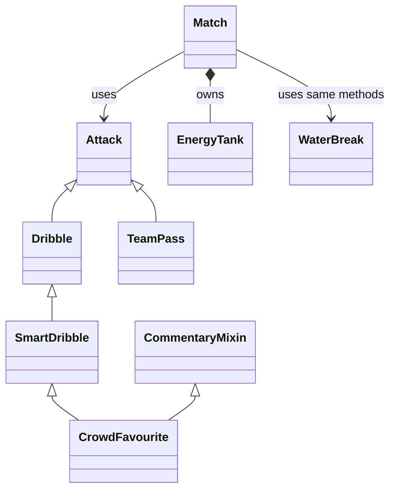

# The Five-a-Side Final

Brian wants one more spectacular dribble. His team has very little energy left and must choose a clever finish.

This story includes all the OOP concepts from Weeks 1 to 6. The numbers are made up for learning.

## Group assignment

The combined assignment is due at the end of **Wednesday, 21 October 2026, Uganda time**. Keep your [foundation work](EXTENSIONS.md), then choose three [later-topic extensions](ADVANCED_EXTENSIONS.md). Each member contributes foundation work and new code or meaningful automated tests through reviewed PRs. The [common assignment](../../GROUP_ASSIGNMENT.md) explains the workflow and what to submit.

## Run this story

If you have not downloaded the files yet, follow [Start here](../../START_HERE.md).

1. Open the repository folder in VS Code.
2. Open `stories/04_five_a_side_final/story.py`.
3. Choose **Run Python File in Terminal**, or use the command below.

From a terminal in the main repository folder:

**Windows:**

```sh
py -3 stories/04_five_a_side_final/story.py
```

**macOS or Linux:**

```sh
python3 stories/04_five_a_side_final/story.py
```

The whole story prints without asking you to type anything. Open [expected_output.txt](expected_output.txt) to see the output of the unchanged program.

## Read the five acts

**Act 1 — the rule keeper.** `EnergyTank` keeps the changing resource. Its constructor sets a valid starting value. Its property getter reads that value. Its setter refuses a negative value. Its action method refuses a request that does not fit. The football story also limits energy to 100.

**Act 2 — the family.** `Attack` is an abstract class. It says that every concrete member of the family must provide `effort()`. `Dribble` and `TeamPass` provide different versions. `super().__init__()` reuses the parent's setup.

**Act 3 — the special choices.** `SmartDribble` extends `Dribble`. `CrowdFavourite` adds the description from `CommentaryMixin` using multiple inheritance. `WaterBreak` is not in the same family but provides the methods the program needs.

**Act 4 — the coordinator.** `Match` creates and owns a `EnergyTank`. It receives a choice object, asks it for its behaviour and lets the resource object check the request. Successful actions go into its own history list. `completed_actions` reads the length of that list and has no setter.

**Act 5 — the complete story.** `main()` creates the objects and runs their actions. Two coordinator objects show that one person's resource and history are separate from another's.

## One request, step by step

`brian.play(actions[2])` asks for effort and finds `SmartDribble.effort()`. It reuses the regular dribble’s 30 and subtracts 10. Match asks its EnergyTank to spend 20 and records the action. The following regular dribble is refused before the tank or completed-actions list changes.

## The ending, with the numbers explained

| Event | Resource after the attempt | Completed count |
|---|---|---|
| Smart dribble | 35 - (30 - 10) = 15 | 1 |
| Regular dribble | Refused: 30 > 15; still 15 | 1 |
| Team pass | 15 - 10 = 5 | 2 |
| Water break | 5 - 0 = 5 | 3 |
| Ruth uses a regular dribble | 40 - 30 = 10 | 1 (Ruth only) |

A refused request changes neither the guarded resource nor the completed-action count.

## How the classes connect



`Dribble` **is a kind of** `Attack`. That is inheritance.

`Match` **has its own** `EnergyTank`. That is composition. It is not a kind of that resource.

Choice objects are created outside the coordinator. Passing them in is association. Keeping references to those independent objects is aggregation.

## Where each concept appears

| Concept | In this story |
|---|---|
| Classes, objects, attributes and methods | The class definitions and the objects created in `main()` |
| Constructors and `self` | Each `__init__`; `self` means the object receiving that call |
| Class and instance attributes | The shared fact on `Attack` and the separate values kept by each object |
| Encapsulation | `EnergyTank` stores a resource and checks its changes |
| Public, `_` and `__` names | Public methods, the internal history list and the name-mangled resource value |
| Getter, validating setter and read-only property | `remaining` on the resource; `completed_actions` on the coordinator |
| Single and hierarchical inheritance | `Dribble` and `TeamPass` inherit `Attack` |
| Multilevel inheritance | `Attack → Dribble → SmartDribble` |
| Multiple and hybrid inheritance | `CrowdFavourite` combines the mixin with that family |
| Overriding and `super()` | The specialised calculation and the added description |
| Polymorphism | The mixed-object loop in `discuss_tactics()` |
| Duck typing | `WaterBreak` works without inheriting `Attack` |
| MRO | The ordered class list printed near the ending |
| Abstraction and abstract classes | `Attack` requires `effort()`; the caller uses it without reproducing its calculation |
| Composition and object collaboration | `Match` owns its resource and works with choice objects |
| UML relationships | The class diagram above |
| Python refresher | Functions, parameters, defaults, returned values, lists, loops, conditions and arithmetic |

Read [OOP in plain English](../../OOP_IN_PLAIN_ENGLISH.md) for a simple explanation of the terms.
