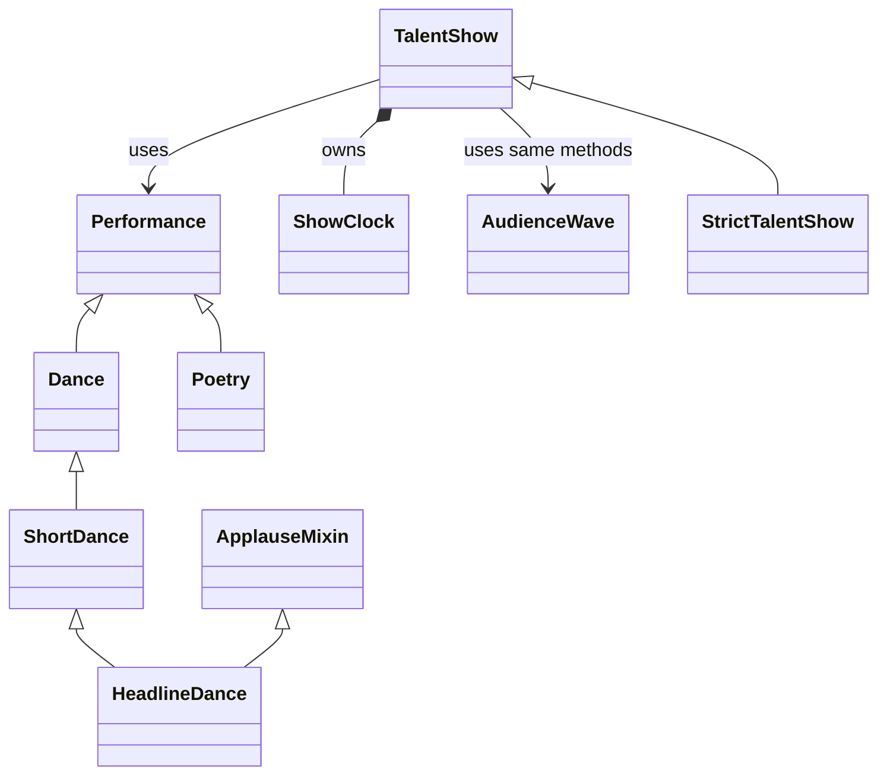

# Campus Talent Show

MC Joel promised a lively student show that finishes on time. A dance crew wants six minutes, but the schedule is already squeezed.

This story includes all the OOP concepts from Weeks 1 to 6. The numbers are made up for learning.

## Group assignment

The combined assignment is due at the end of **Wednesday, 21 October 2026, Uganda time**. Keep your [foundation work](EXTENSIONS.md), then choose three [later-topic extensions](ADVANCED_EXTENSIONS.md). Each member contributes foundation work and new code or meaningful automated tests through reviewed PRs. The [common assignment](../../GROUP_ASSIGNMENT.md) explains the workflow and what to submit.

## Run this story

If you have not downloaded the files yet, follow [Start here](../../START_HERE.md).

1. Open the repository folder in VS Code.
2. Open `stories/05_campus_talent_show/story.py`.
3. Choose **Run Python File in Terminal**, or use the command below.

From a terminal in the main repository folder:

**Windows:**

```sh
py -3 stories/05_campus_talent_show/story.py
```

**macOS or Linux:**

```sh
python3 stories/05_campus_talent_show/story.py
```

The whole story prints without asking you to type anything. Open [expected_output.txt](expected_output.txt) to see the output of the unchanged program.

## Read the five acts

**Act 1 — the rule keeper.** `ShowClock` keeps the changing resource. Its constructor sets a valid starting value. Its property getter reads that value. Its setter refuses a negative value. Its action method refuses a request that does not fit.

**Act 2 — the family.** `Performance` is an abstract class. It says that every concrete member of the family must provide `duration()`. `Dance` and `Poetry` provide different versions. `super().__init__()` reuses the parent's setup.

**Act 3 — the special choices.** `ShortDance` extends `Dance`. `HeadlineDance` adds the description from `ApplauseMixin` using multiple inheritance. `AudienceWave` is not in the same family but provides the methods the program needs.

**Act 4 — the coordinator.** `TalentShow` creates and owns a `ShowClock`. It receives a choice object, asks it for its behaviour and lets the resource object check the request. Successful actions go into its own history list. `act_count` reads the length of that list and has no setter.

**Act 5 — the complete story.** `main()` creates the objects and runs their actions. Two coordinator objects show that one person's resource and history are separate from another's.

## One request, step by step

`joel.book(acts[2])` asks the headline dance for its duration. `ShortDance.duration()` gets the parent’s 6 and halves it to 3. The ShowClock reserves 3, leaving 5, and the act enters the lineup. The later full dance is refused; poetry and an audience wave fill the remaining time.

## The ending, with the numbers explained

| Event | Resource after the attempt | Completed count |
|---|---|---|
| Short dance | 8 - (6 // 2) = 5 minutes | 1 |
| Full dance | Refused: 6 > 5; still 5 | 1 |
| Poetry | 5 - 4 = 1 minute | 2 |
| Audience wave | 1 - 1 = 0 minutes | 3 |
| Faith books full dance | 6 - 6 = 0 minutes | 1 (Faith only) |

A refused request changes neither the guarded resource nor the completed-action count.

## Strict booking and typed errors

The original `TalentShow.book()` remains the baseline action. `StrictTalentShow`
adds `safe_book(choice)` for callers that need a reason when a booking cannot
proceed: `ShowChoiceError` means no choice was supplied, `ShowRequestError`
means the calculated duration is negative, and `ShowResourceError` means the
valid duration exceeds the time left. These checks happen before `book()` can
spend time or record an act. A zero-minute choice is allowed and can be booked
without reducing the clock.

Run the friendly-error demo from the repository root:

```sh
py -3 stories/05_campus_talent_show/demo_MWESIGE_ARNOLD_B33236.py
```

Run the automated checks with:

```sh
py -3 stories/05_campus_talent_show/test_strict_talent_show.py
```

## How the classes connect



`Dance` **is a kind of** `Performance`. That is inheritance.

`TalentShow` **has its own** `ShowClock`. That is composition. It is not a kind of that resource.

Choice objects are created outside the coordinator. Passing them in is association. Keeping references to those independent objects is aggregation.

## Where each concept appears

| Concept | In this story |
|---|---|
| Classes, objects, attributes and methods | The class definitions and the objects created in `main()` |
| Constructors and `self` | Each `__init__`; `self` means the object receiving that call |
| Class and instance attributes | The shared fact on `Performance` and the separate values kept by each object |
| Encapsulation | `ShowClock` stores a resource and checks its changes |
| Public, `_` and `__` names | Public methods, the internal history list and the name-mangled resource value |
| Getter, validating setter and read-only property | `remaining` on the resource; `act_count` on the coordinator |
| Single and hierarchical inheritance | `Dance` and `Poetry` inherit `Performance` |
| Multilevel inheritance | `Performance → Dance → ShortDance` |
| Multiple and hybrid inheritance | `HeadlineDance` combines the mixin with that family |
| Overriding and `super()` | The specialised calculation and the added description |
| Polymorphism | The mixed-object loop in `audition()` |
| Duck typing | `AudienceWave` works without inheriting `Performance` |
| MRO | The ordered class list printed near the ending |
| Abstraction and abstract classes | `Performance` requires `duration()`; the caller uses it without reproducing its calculation |
| Composition and object collaboration | `TalentShow` owns its resource and works with choice objects |
| UML relationships | The class diagram above |
| Python refresher | Functions, parameters, defaults, returned values, lists, loops, conditions and arithmetic |

Read [OOP in plain English](../../OOP_IN_PLAIN_ENGLISH.md) for a simple explanation of the terms.
