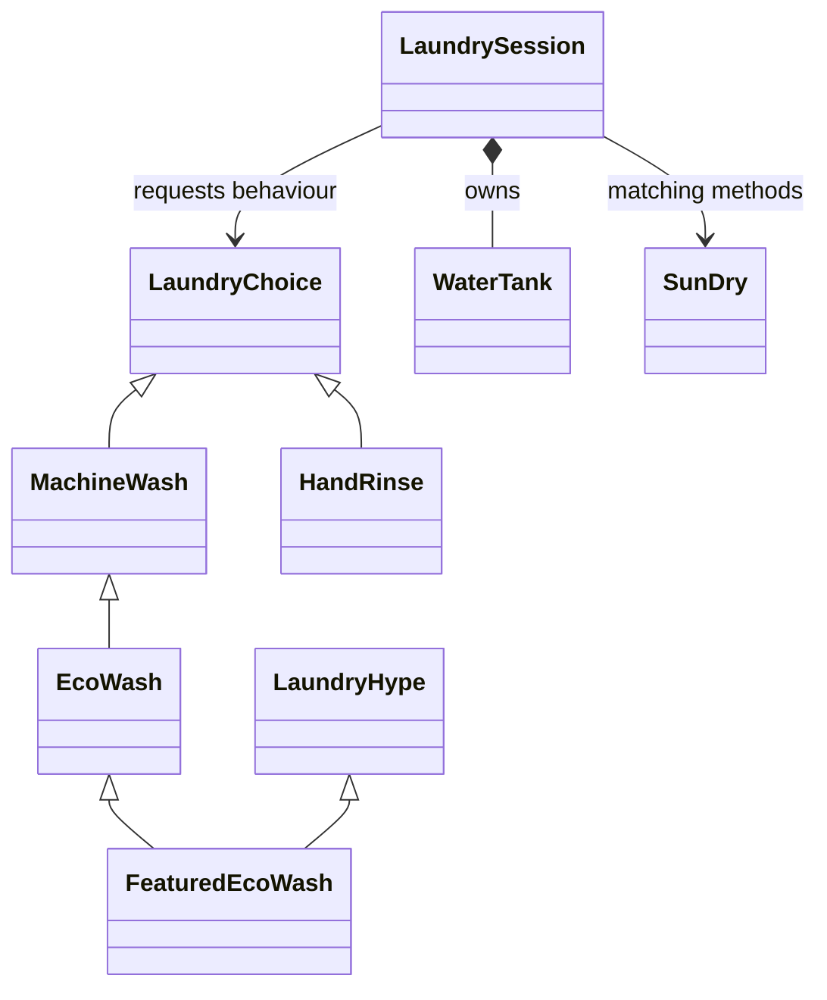

# Laundry Day Before the Presentation

**Assigned to Catch-up Group C1**, which is Group 1 in the lecturer's additional group list. It has 8 members. This label is separate from the original class group numbers.

Nambi needs clean clothes for a presentation. The hostel water tank is nearly empty.

This is a made-up Ugandan student story. Its prices, resource use and events are learning examples. Your goal is to help the main character make choices without losing track of the resource.

## Your work

1. Run and understand the complete starting story below.
2. Complete [one foundation extension per member](EXTENSIONS.md). Your group has eight choices.
3. As a team, choose **three** [later-topic extensions](ADVANCED_EXTENSIONS.md).
4. Follow the [common group instructions](../../GROUP_ASSIGNMENT.md) and submission requirements.

**Deadline: end of Wednesday, 21 October 2026, Uganda time.**

## Run the story

Download or clone the repository using [Start here](../../START_HERE.md). Open the main repository folder in VS Code.

**Windows:**

```sh
py -3 stories/07_laundry_day/story.py
```

**macOS or Linux:**

```sh
python3 stories/07_laundry_day/story.py
```

No extra packages are needed. The whole story prints without asking for input. Compare with [expected_output.txt](expected_output.txt).

## Read it in five short acts

**Act 1: WaterTank.** This object owns the remaining litres. The property setter checks the starting value and later assignments. `use()` refuses an amount that does not fit before changing anything. A double underscore changes the internal attribute name; it is not a password lock.

**Act 2: LaundryChoice.** This abstract class requires `water_needed()`. `MachineWash` calculates a requirement from a quantity; `HandRinse` uses a fixed requirement. Each choice inherits its name and description interface. `super().__init__()` reuses common setup. Quantities must be positive whole numbers.

**Act 3: specialised choices.** `EcoWash` reuses its parent's calculation and adjusts it. `FeaturedEcoWash` combines this class with `LaundryHype`. The mixin adds a cheerful description. `SunDry` has no shared parent but supplies the methods the caller needs. That is duck typing.

**Act 4: LaundrySession.** This coordinator creates and owns its `WaterTank`. It receives an independent choice and asks for its requirement. If the resource approves, the coordinator records the success. The history is `_entries`, a list of dictionaries containing the choice object and the cost **at the time of success**. This saved cost will help with accurate cancellation later.

**Act 5: the ending.** `main()` creates two separate coordinators. The first tries an ordinary choice, a special choice and a request that will not fit. The second has its own resource and history. The printed MRO shows the order Python uses to find methods.

## Follow one request

`session.book(choice)` asks `choice.water_needed()` for the needed amount. It then asks `session.water.use(needed)` to check and spend that amount. Only a successful action goes into `_entries`. A zero-cost choice is explicitly allowed; a negative requirement is refused. A refusal leaves the resource and completed count unchanged.

The quantities and units are deliberately simple. Integer division `//` rounds down in the half-cost variants; these are toy whole-unit requirements, not real provider estimates.

## How the classes connect



A triangle points to a parent. A filled diamond means an owned component. A plain arrow means collaboration. The choices are created outside the coordinator and can exist independently; storing them in history is aggregation.

## All the Week 1–6 ideas are here

| Idea | Where it appears |
|---|---|
| Classes and objects | Class definitions and the two coordinator objects in `main()` |
| Attributes, methods, constructors and `self` | Per-object state, `__init__`, and calls on each receiving object |
| Class versus instance attributes | Shared `unit` on the base class; each instance's name and quantity |
| Encapsulation | The resource keeps its value and checks together |
| Getter and validating setter | The `remaining` property, also used during construction |
| Read-only property | `completed_count` is derived from history and has no setter |
| Public / `_` / `__` | Public operations, `_entries`, and the name-mangled resource value |
| Single and hierarchical inheritance | Two concrete children of `LaundryChoice` |
| Multilevel inheritance | `LaundryChoice → MachineWash → EcoWash` |
| Multiple and hybrid inheritance | `FeaturedEcoWash(LaundryHype, EcoWash)` |
| Overriding and `super()` | Specialised requirement and added description |
| Polymorphism | `show_choices()` calls the same method on different objects |
| Duck typing | `SunDry` works without inheriting `LaundryChoice` |
| MRO | The class list printed at the end; `super()` follows this order |
| Abstraction | The caller uses `water_needed()` without copying its formula |
| Composition | The coordinator creates its own resource |
| Association and aggregation | Passed-in choices and references retained in history |
| Python refresher | Functions, conditions, lists, dictionaries, loops and returned values |

[OOP in plain English](../../OOP_IN_PLAIN_ENGLISH.md) explains the vocabulary. The code is a starting example; the extension sheets describe the work your group must add.
